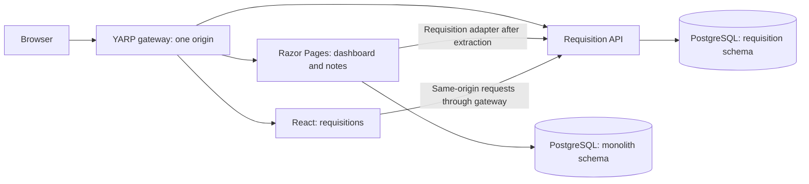

# Strangler Fig with Razor Pages and React

An ASP.NET Core Razor Pages application that keeps its dashboard and notes while its requisition approval feature moves into an ASP.NET Core API and React. Requesters draft and submit hiring requests; designated approvers accept or reject them.

**Status: proposed architecture.** This revision contains design documents only. The application, migration, local runtime and rollback behavior are not implemented or verified yet.

The diagram shows the intended extracted state. Both schemas belong to the same PostgreSQL database. React's API arrow represents a browser request through YARP, not a direct public API listener.

The migration separates two changes: moving business and data ownership into the API, then switching the requisition page from Razor to React. The Razor requisition page remains an API client after extraction, so changing the page route does not restore an obsolete database writer.

- [Design and request flow](docs/design.md)
- [Boundary and rollback decision](docs/decisions/0001-strangler-boundary.md)
- [Technical sources and decisions](docs/research.md)

Startup and operating commands will be documented when the corresponding runtime exists. This architecture does not claim uninterrupted feature writes during ownership transfer or production deployment readiness.
