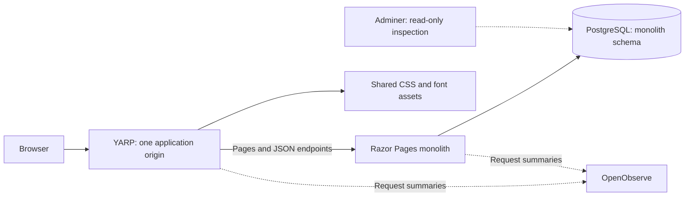
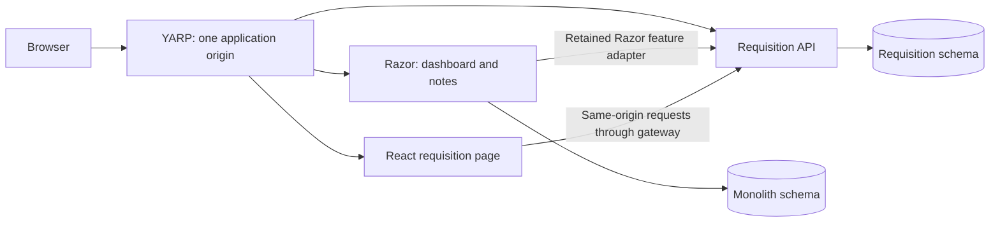

# Strangler Fig with Razor Pages and React

A running ASP.NET Core Razor Pages application for requisition approval. Requesters save drafts and submit them; designated approvers approve or reject assigned requests. Dashboard and private notes remain part of the monolith.

The current application is the original monolith. Its Razor pages and JSON endpoints use the same requisition behavior and PostgreSQL persistence. API extraction and the React route are planned; they are not active runtime components.



## Run locally

Install Docker with Compose v2, Make, POSIX `sh`, `openssl`, `curl`, `jq` and Git. The pinned container SDK builds and tests .NET; a host .NET installation is not required.

```sh
make help
make up
make sample
```

`make up` creates ignored local credentials, provisions the log ingestion credential, builds the application and starts its dependencies. `make sample` signs in as the synthetic requester and creates a submitted requisition in the actual application database.

| Surface | Default URL | Sign-in |
| --- | --- | --- |
| Application | [app.localhost:5190](http://app.localhost:5190) | `alex` requester or `sam` approver; corresponding `.secrets/alex_password` or `.secrets/sam_password` file. |
| API reference | [app.localhost:5190/reference/](http://app.localhost:5190/reference/) | Existing application session; available only in the configured `Local` environment. |
| Adminer | [db.localhost:5191](http://db.localhost:5191) | Fixed PostgreSQL connection `postgres`, database `strangler`, user `viewer_app`; password from `.secrets/pgviewer_password`. |
| OpenObserve | [logs.localhost:5192](http://logs.localhost:5192) | Synthetic local account `logs@lab.example`; password from `.secrets/openobserve_password`. |

Read credential files locally when signing in; keep them outside source control. The database viewer receives no mounted database password. Use the separate browser hostnames above so the host-only application cookie stays on the application host. All published listeners bind to `127.0.0.1`; PostgreSQL and the monolith have no published host port.

In the application, save a draft as `alex`, save any edits, then submit. Sign out and sign in as `sam` to decide the assigned request. Rejection requires a reason. Submitting unsaved edits keeps the entered text and asks you to save it first.

The authenticated API reference uses packaged scripts and the current browser session. For JSON mutations, obtain a token from `GET /api/antiforgery` after signing in and supply it as `X-CSRF-TOKEN`. The reference does not bypass authorization or antiforgery validation.

## Operating commands

| Command | Behavior |
| --- | --- |
| `make help` | List supported commands without starting services. |
| `make setup` | Create owner-only ignored credentials and preserve existing values. |
| `make telemetry-setup` | Start OpenObserve and provision the separate ingestion-only credential. |
| `make up` | Build, start and wait for the application and viewers. |
| `make sample` | Create and submit a synthetic request through the public gateway. |
| `make logs` | Follow bounded container output; Ctrl-C stops following. |
| `make restart` | Restart services while retaining data and authentication keys. |
| `make down` | Stop services while retaining named volumes. |
| `make build` | Build the production application images. |
| `make test` | Run backend and rendered-form tests against isolated PostgreSQL. |
| `make source-check` | Restore locked dependencies and run the Release build with warnings as errors. |
| `make format-check` | Verify .NET formatting. |
| `make script-test` | Check shell syntax and isolated command behavior. |
| `make mount-check` | Verify service credential mount isolation without printing values. |
| `make security` | Scan source, dependencies, Git history and selected images. |
| `make check` | Run the combined checks, tests, image build and scans. |

Override the application, database viewer or log viewer ports with `APP_PORT`, `DB_VIEWER_PORT` or `LOGS_PORT`. `COMPOSE_PROJECT_NAME` selects the Compose project. Ordinary stop and restart retain database records, log data and the persistent data-protection keyring. No Make target deletes volumes. Database initialization runs only for a new data directory; changing a credential file does not rotate a password already stored in PostgreSQL.

OpenObserve receives allowlisted request summaries. Use the response `X-Correlation-ID` to find the corresponding gateway and monolith events in its Logs view. Submitted text, cookies and credentials are excluded from these summaries.

## Planned extraction



This planned state retains one PostgreSQL database. Ownership moves to the API before page routing changes to React. The retained Razor feature page will use that same API, so UI rollback cannot restore an obsolete database writer. A bounded feature-write drain is expected during ownership transfer; uninterrupted feature writes are not claimed.

- [Current design and planned request flow](docs/design.md)
- [Boundary and rollback decision](docs/decisions/0001-strangler-boundary.md)
- [Technical sources and repository pins](docs/research.md)
