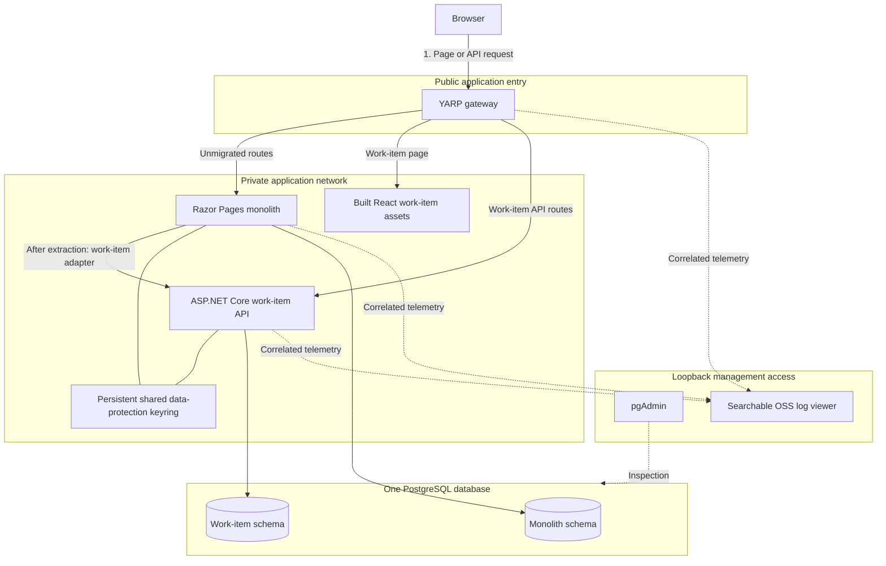

# Design

Status: proposed. Components and behavior below describe the intended application, not observed runtime guarantees.

## Feature boundary

A signed-in user can create, list and update their own work items. Each item has a stable identifier, owner, title, status and concurrency version. Dashboard and personal notes remain Razor Pages responsibilities. Operations are bounded synchronous requests; there is no background job or document-upload flow.

The original application must first work as a monolith, including work-item persistence. Extraction then moves that existing feature into an API without recreating its records. React replaces only the feature's presentation.

## Intended topology

The final work-item page can be routed to React or to the Razor adapter. Both use the same API after extraction. Application listeners and the database remain private to the runtime network; the gateway is the business entry point. Inspection traffic is separate from business traffic.

| Component | Responsibility |
| --- | --- |
| YARP gateway | Dispatch page and API routes under one origin with explicit precedence and bounded forwarding. |
| Razor Pages monolith | Sign-in, dashboard, notes and the retained work-item page adapter. |
| React feature | Render work items, validate form input for usability and issue same-origin API requests. |
| Work-item API | Authorize owners, validate requests, enforce concurrency and own feature persistence. |
| PostgreSQL | Persist monolith and feature records using separate schemas and runtime privileges. |
| Shared keyring | Preserve compatible authentication ticket protection across trusted server applications and ordinary restarts. |
| pgAdmin | Inspect schemas, permissions and synthetic database records outside the business path. |
| Searchable log viewer | Query allowlisted events by correlation identifier without becoming a request dependency. |

## User-to-result flow after extraction

1. The browser requests a page through YARP. Dashboard and notes resolve to Razor Pages; the feature route resolves to its selected page implementation.
2. The monolith handles sign-in and issues the application authentication cookie. The API validates compatible tickets using the shared protection settings; each operation still applies its own authorization.
3. React loads the current user's bounded work-item list through the gateway. The retained Razor page uses its server-side API adapter for the equivalent operation.
4. A mutation carries the authentication context, antiforgery proof, validated fields and the expected item version where applicable. Owner identity comes from the authenticated principal, never a client-selected owner field.
5. The API validates the operation and performs a short owner-scoped database transaction. A stale version produces an explicit conflict rather than silently overwriting another edit.
6. The API returns the authorized persisted result or a safe error. The current page renders the result and announces relevant status accessibly.
7. Correlated, allowlisted events make the gateway and application handoffs inspectable. Cookies, credentials and work-item bodies do not enter telemetry.

Native links move between the React feature and Razor pages with full-page navigation. This keeps each rendering system responsible for its own page lifecycle. A failed request preserves recoverable user input and offers an explicit retry; no automatic fallback writes to a legacy store.

## Data ownership and extraction

Initially the monolith owns work-item behavior and persistence. The extracted state assigns logical ownership to the API and denies the monolith runtime role direct access to feature records. Schema ownership and migration privileges belong to a controlled migration role; runtime credentials do not need schema-changing privileges.

The intended expand-contract transition is:

1. Introduce the feature API and a compatible Razor adapter without admitting a second independent writer.
2. Establish a bounded feature-write drain and verify the active writer before changing ownership. Dashboard and notes remain separate routes.
3. Execute the controlled schema/privilege transition with appropriate locking, preserving work-item identifiers, owners, values, timestamps, versions and constraints. Activate API access only under the intended ownership state.
4. Verify the retained records through the API and confirm the former runtime writer is denied direct feature access.
5. Use the API-backed Razor page before independently switching the public feature page to React.
6. Retire obsolete direct feature persistence after the compatible path is established.

This is a schema-and-permission extraction within one PostgreSQL database. It is not a physical database transfer, dual-write solution or claimed zero-interruption migration. Locking, in-flight operations, migration interruption and retry behavior require implementation and direct verification.

## Security and failure behavior

Both feature presentations use the same API validation, owner filtering and concurrency rules. Mutating cookie-authenticated requests require antiforgery protection. Shared authentication keys make the server applications mutually trusted; keys require restricted storage and persistent handling. The React bundle receives neither keys nor database credentials.

If the API is unavailable, feature operations fail visibly without restoring the old writer. Unmigrated pages continue using their own data boundary where their dependencies remain healthy. If PostgreSQL is unavailable, the application reports a safe storage failure. A telemetry outage must not fail a business operation; buffered export and fallback output must be bounded.

UI rollback changes which page serves the feature. It does not reverse API ownership. Reverting the backend requires a separate data-and-permission transition with explicit compatibility and recovery checks. Do not re-enable stale direct writers by changing a proxy route.

## Local operating boundary

The intended runtime uses Docker Compose, persistent named volumes, private service networking, loopback review and management listeners, and ignored local credentials. Ordinary stop and restart must preserve application data and the keyring. pgAdmin must connect to the actual lab database; the log viewer must contain correlated synthetic request events.

The root Makefile will expose implemented startup, sample, checks, build, logs, restart and stop operations. Startup commands and viewer URLs are intentionally absent until they exist and can be exercised. Local service replicas do not prove a highly available deployment, and sharing a database remains an operational coupling.
